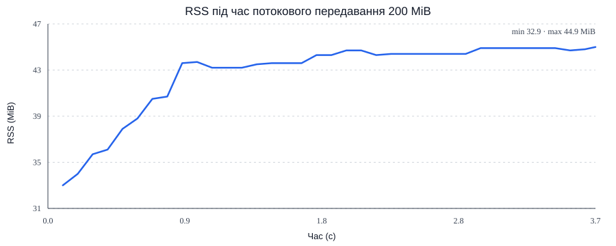

Dogfight — Lab 04

Експеримент 1. Node.js та HTTP-сервер

Проєкт поділено на `client/` і `server/`. Клієнт збирається Vite, а сервер на Node.js віддає зібрані файли та обробляє `GET /api/rooms`, `POST /api/rooms` і `GET /health`. Для статичних файлів перевіряється шлях, щоб не дозволити доступ до файлів поза каталогом клієнта.

Висновок: Node.js може обслуговувати HTTP-запити й працювати з файловою системою без браузерного DOM.

Експеримент 2. Кімнати та WebSocket-чат

Кімнати реалізовані класом `Room`, який успадковує `EventEmitter`. Коли гравець входить або виходить, сервер надсилає оновлений список учасників. Повідомлення чату передаються іншим гравцям тієї самої кімнати. Сервер перевіряє тип, версію та форму кожного повідомлення, обмежує розмір і частоту повідомлень. Якщо клієнт не надсилає `join` протягом п'яти секунд, з'єднання закривається.

Висновок: сервер не довіряє даним клієнта, а WebSocket дає змогу обмінюватися повідомленнями в обидва боки через одне з'єднання.

Експеримент 3. Повторне підключення та контроль з'єднання

Клієнт має чергу вихідних повідомлень і повторно підключається після втрати з'єднання. Затримка між спробами поступово збільшується. Сервер надсилає ping кожні 15 секунд і закриває з'єднання, якщо не отримує pong. Для повільних клієнтів сервер не надсилає некритичні повідомлення, коли `bufferedAmount` перевищує ліміт.

Висновок: повторне підключення й контроль черги допомагають пережити короткі мережеві збої, а обмеження буфера не дає повільному клієнту накопичувати необмежену кількість даних.

Експеримент 4. Запис і відтворення логів через streams

Події кімнати перетворюються на рядки NDJSON через `Transform` і записуються у файл за допомогою `pipeline`. Маршрут `GET /api/replays/:id` передає файл у відповідь потоком, не завантажуючи його цілком у пам'ять. `pipeline` передає backpressure від повільного споживача назад джерелу й обробляє помилки потоку.

Висновок: потокова обробка дає змогу передавати великі файли частинами, не створюючи в пам'яті другу повну копію файлу.

Експеримент 5. RSS і backpressure

Для відтворюваної перевірки запусти `npm run experiment:backpressure`. Скрипт генерує потік розміром 200 MiB, затримує кожен блок і передає дані через `pipeline`. Вимірювання RSS записуються в `server/logs/rss-samples.csv`. Під час запуску на цій машині передалося 200 MiB за 45,12 с; RSS коливався в межах 43–57,4 MiB. Значення залежать від середовища, але пам'ять не зросла на 200 MiB. Графік `docs/rss-backpressure.svg` побудовано за виміряними зразками RSS.



Висновок: backpressure сповільнює виробника, коли споживач не встигає читати дані. Без нього внутрішні буфери можуть постійно збільшуватися.

Експеримент 6. Цикл подій і блокування

JavaScript-код Node.js виконується в одному основному потоці. Якщо HTTP-обробник виконує синхронний цикл протягом 300 мс, у цей час сервер не може обробити інші запити, повідомлення WebSocket або таймери. Фази циклу подій libuv включають timers, pending callbacks, poll, check і close callbacks. `process.nextTick` та Promise-обробники виконуються між фазами; `setImmediate` працює у фазі check. Порядок `setTimeout(fn, 0)` і `setImmediate` на верхньому рівні не гарантований. Для демонстрації відкрий два вікна з грою та на одній вкладці виконай у DevTools `fetch("/api/slow")`. Поки маршрут виконує синхронний цикл приблизно 300 мс, чат в обох вікнах короткочасно затримається, бо цикл подій заблокований.

Висновок: навіть якщо операції вводу-виводу асинхронні, довгий синхронний JavaScript блокує весь процес. Важкі обчислення потрібно виносити з основного потоку.

Експеримент 7. Подія `error`

`EventEmitter` має особливу поведінку: якщо емітер викликає `emit("error", error)` і для події `error` немає слухача, Node.js кидає помилку, яка може завершити процес. Тому кімнати, WebSocket-з'єднання та потоки мають обробники помилок. Для Promise потрібно обробляти відхилення через `try/catch` або `.catch()`; необроблене відхилення також може призвести до завершення процесу залежно від налаштувань Node.js.

```js
import { EventEmitter } from "node:events";
const emitter = new EventEmitter();
// Без слухача emit кидає помилку і може завершити процес:
// emitter.emit("error", new Error("boom"));

emitter.on("error", (error) =>
  console.error("Оброблена помилка:", error.message),
);
emitter.emit("error", new Error("boom"));
```

Приклад виводу після додавання слухача: `Оброблена помилка: boom`.

Висновок: помилки асинхронних API потрібно обробляти явно, інакше збій окремої операції може зупинити весь сервер.

Запуск і перевірка

1. Встановити Node.js 22 або новішу LTS-версію.
2. Виконати `npm install` у корені репозиторію.
3. За потреби скопіювати `.env.example` у `server/.env` і змінити значення.
4. Виконати `npm run dev` та відкрити адресу Vite, яку покаже термінал.
5. Відкрити сторінку у двох вікнах, ввести різні імена, вибрати одну кімнату та перевірити список учасників і чат.
6. `npm run build`, `npm run lint` і `npm test` запускають збірку, перевірку коду й тести.
7. Для production: виконати `npm run build`, потім `npm start`; сервер віддає файли з `client/dist`.

Reflection

- Чому `setTimeout(..., 0)` і `setImmediate` можуть виконатися в різному порядку на верхньому рівні? На верхньому рівні порядок залежить від того, коли цикл подій почне обробляти таймери та фазу check; усередині I/O callback `setImmediate` виконується у фазі check поточної ітерації.
- Як Node.js читає файли, якщо JavaScript працює в одному потоці? Асинхронний I/O виконується через можливості операційної системи та механізми libuv; частина операцій, зокрема файлові операції й DNS, використовує thread pool. Сам JavaScript callback усе одно виконується в основному потоці.
- Чим відрізняються CommonJS та ESM? CommonJS використовує `require` і `module.exports`; ESM — `import` і `export`. ESM має статичні імпорти та підтримує `import.meta`; `__dirname` замінюють шляхом, обчисленим від `import.meta.url`.
- Що таке backpressure? Це механізм, за яким повільний споживач сигналізує, що виробник має зменшити швидкість. `write()` повертає `false`, коли буфер переповнений; запис варто призупинити до `drain`. `pipeline` автоматизує передавання даних, обробку backpressure та помилок.
- Чим відрізняються Readable, Writable, Duplex і Transform? Readable читає дані, Writable записує, Duplex підтримує обидва напрямки, Transform читає й записує, змінюючи дані. TCP-сокет є двонапрямним потоком.
- Чому потрібен слухач `error`? Для `EventEmitter` подія `error` без слухача кидає помилку. Відхилення Promise слід обробляти через `catch` або `try/catch`.
- Чому сервер перевіряє повідомлення, якщо клієнт написаний нами? Клієнт можна змінити або підробити запити; перевірка на сервері захищає протокол, ресурси й інші підключення.
